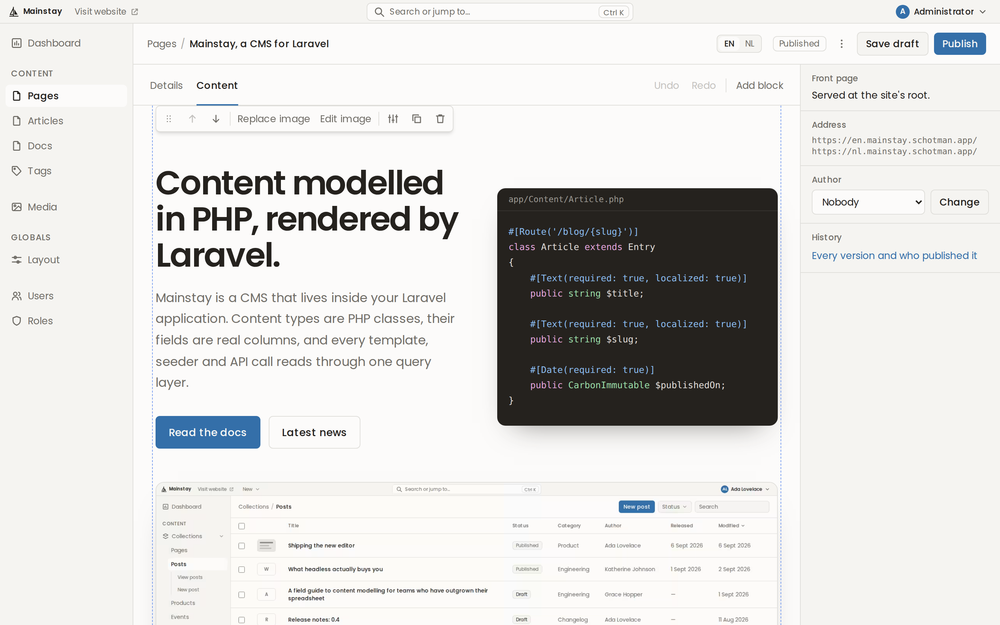
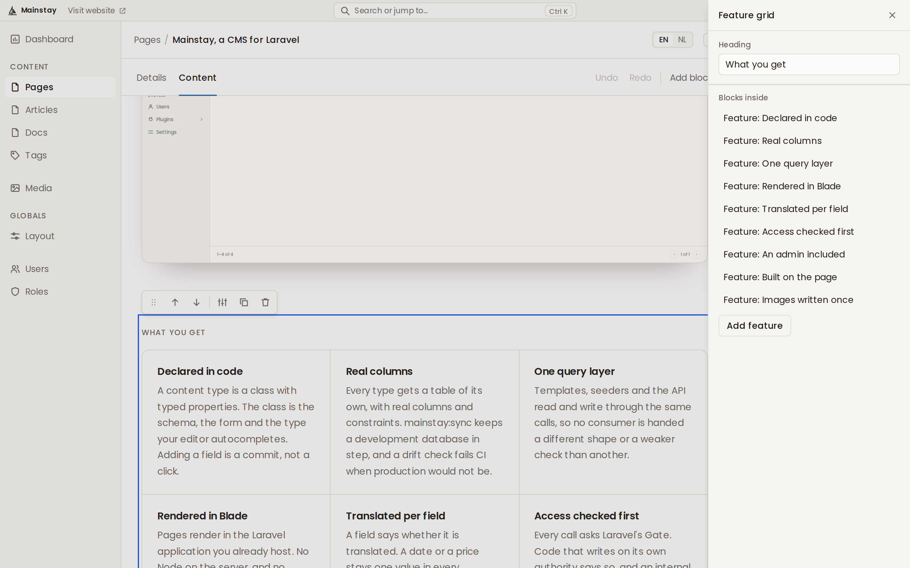
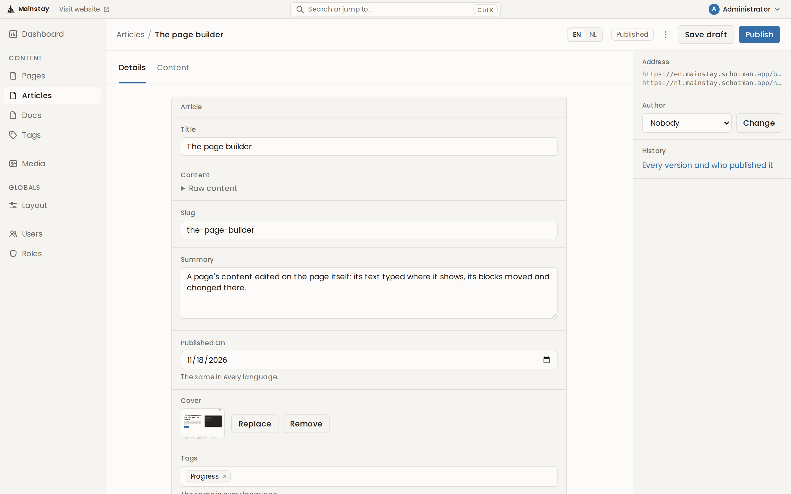
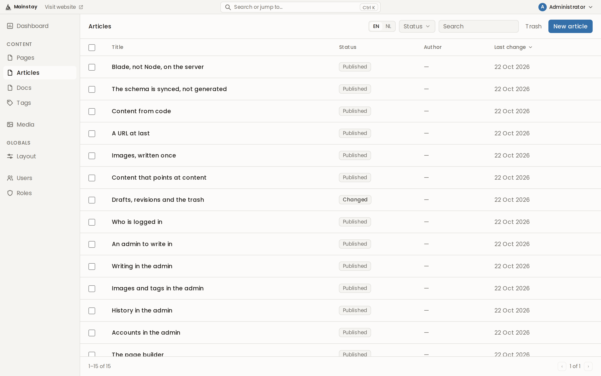
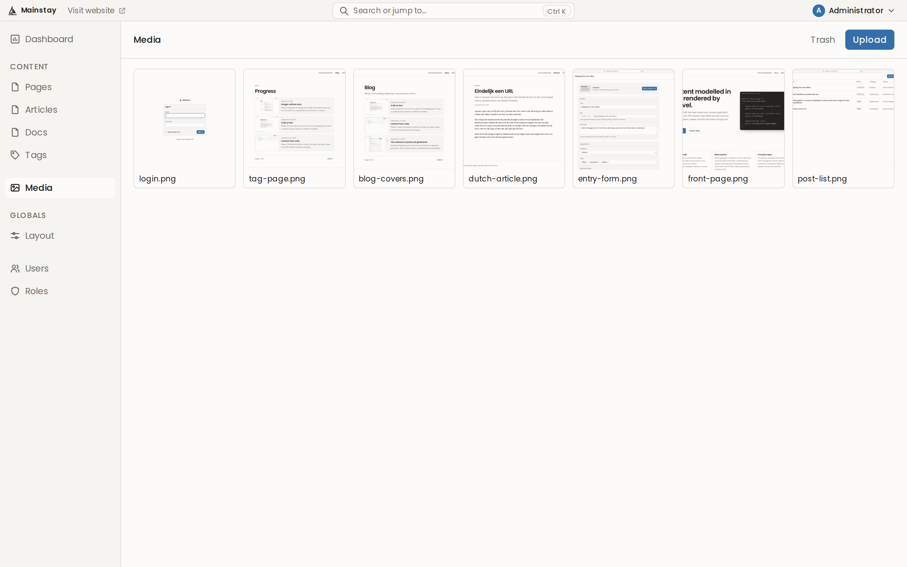
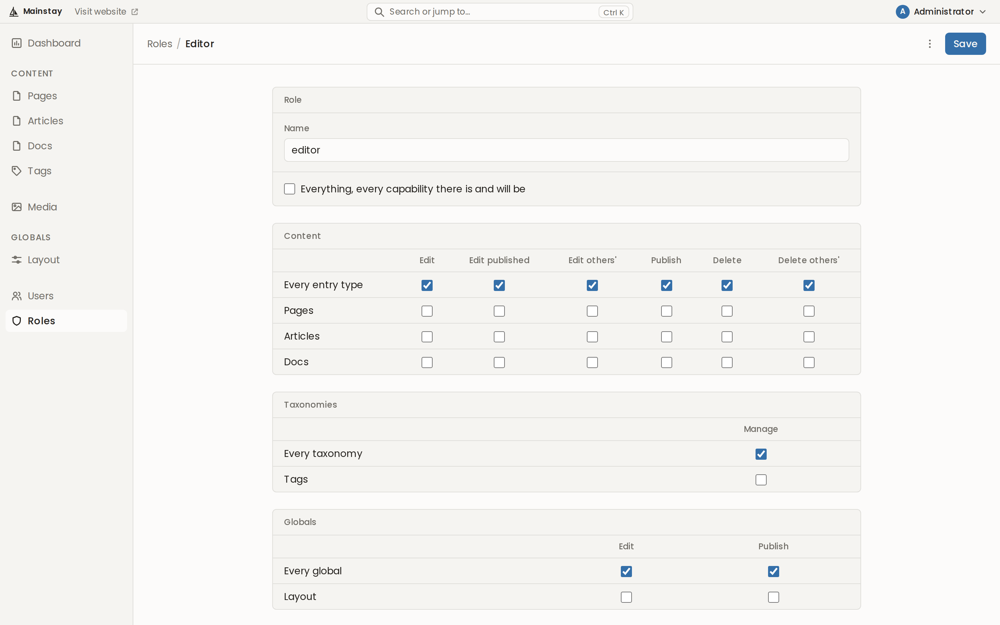
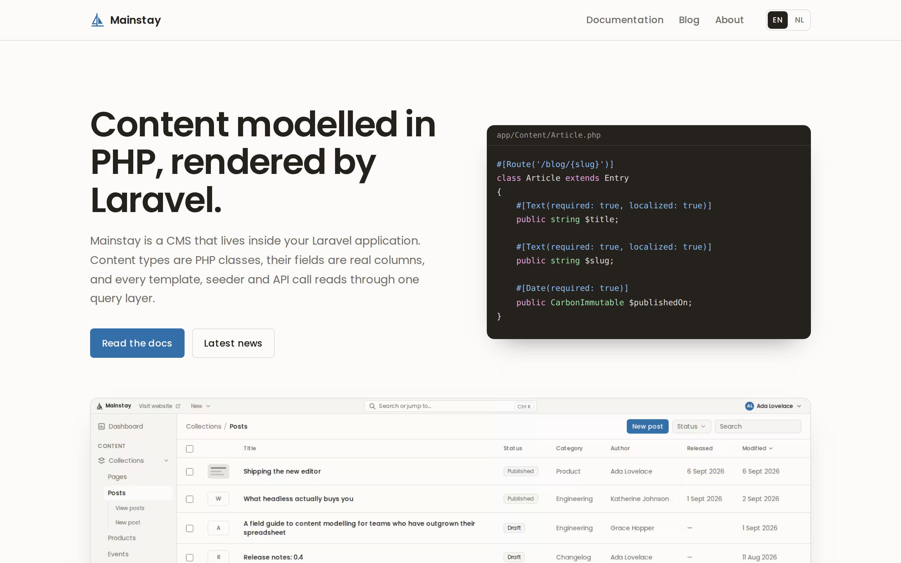

<p align="center">
  
</p>

<h1 align="center">Mainstay</h1>

<p align="center">
  A CMS for Laravel. Content is modelled in PHP, stored in real columns, built in an admin with a
  page builder, and served by your own application.
</p>

<p align="center">
  <a href="https://github.com/schotman-development/mainstay/actions/workflows/ci.yml"></a>
  
  
  <a href="LICENSE"></a>
</p>

<p align="center">
  <a href="#features">Features</a> ·
  <a href="#screenshots">Screenshots</a> ·
  <a href="#getting-started">Getting started</a> ·
  <a href="#roadmap">Roadmap</a> ·
  <a href="#working-on-mainstay">Contributing</a>
</p>

<p align="center">
  
</p>

> [!NOTE]
> Mainstay is early and not released yet. Everything below works today and is tested on SQLite,
> PostgreSQL, MySQL and SQL Server, but its API can still change between commits.

## Why Mainstay

The CMSs that model content well need Node on the server, and the ones that run on a plain PHP host
keep content as rows in a meta table. Mainstay takes the first kind's model -- content declared in
code, with real columns underneath -- and puts it inside a Laravel application, where Blade renders
it. Its content API opens to other front ends in the next phase.

Mainstay owns its tables inside your app. "Headless" describes the consumer, not the storage.

## Features

- **Content types are PHP classes.** Typed properties with attributes are the schema, the form and
  the type your editor autocompletes. Adding a field is a commit, not a click.
- **Real columns.** Every type gets a table of its own with real columns and constraints.
  `mainstay:sync` keeps a development database in step, and `mainstay:schema:check` tells you what
  production's migrations still need.
- **One query layer.** Templates, seeders, the admin and the API read and write through
  `Mainstay::find()`, `create()`, `update()` and `delete()`, and every call asks Laravel's Gate first.
- **A page builder.** Every entry has content: text and the blocks its type allows, each block a PHP
  class drawn by its own Blade view. The admin's Content tab is the page as your site draws it, with
  text typed in place, blocks added, dragged and nested, and each block's fields and images edited in
  dialogs beside it.
- **Served by Laravel.** An entry is served at the path its `#[Route]` builds, through a Blade
  template, after any route your app declares itself. No Node on the server.
- **Translated per field.** A field says whether it is translated. A title gets one value per
  language, a date or a price stays one, and each language is served on its own host or path prefix.
- **Images written once.** An installation-wide media library with alt text in every language and a
  focal point. Every size a field declares is written as AVIF and WebP the moment a file arrives.
- **Relations, tags and globals.** Entries point at each other through relations a read follows to a
  depth, tags are the entries of a taxonomy, and a global holds a site's menu and footer.
- **Drafts, history and the trash.** A change waits as a draft until it is published, every version a
  publish replaces can be restored, and a deleted entry waits in the trash.
- **Accounts and roles.** The admin has its own sign-in. Accounts are invited by mail, and a role's
  capabilities are a grid of the types you register.

## Screenshots

<table>
  <tr>
    <td width="50%"></td>
    <td width="50%"></td>
  </tr>
  <tr>
    <td align="center">Block settings, with the blocks inside it</td>
    <td align="center">An entry's details</td>
  </tr>
  <tr>
    <td></td>
    <td></td>
  </tr>
  <tr>
    <td align="center">A type's entries</td>
    <td align="center">The media library</td>
  </tr>
  <tr>
    <td></td>
    <td></td>
  </tr>
  <tr>
    <td align="center">A role's capabilities</td>
    <td align="center">A site built with it</td>
  </tr>
</table>

## Getting started

### Requirements

- PHP 8.3 or newer, with GD for images
- Laravel 13
- SQLite, PostgreSQL, MySQL or SQL Server

### Install

```bash
composer require mainstay/cms
php artisan vendor:publish --tag=mainstay-assets
```

The admin is then at `/admin`, behind a sign-in of its own, and the content API at `/api/mainstay`.
Every other path an entry holds is answered by Mainstay's catch-all, after any route your app
declares itself. The two paths, their middleware, an optional dedicated domain, where each content
language is served, and the catch-all's middleware, or whether it runs at all, are configurable:

```bash
php artisan vendor:publish --tag=mainstay-config
```

Nothing on the web makes the first account. Make it on the server, and invite the rest from the
admin's Users:

```bash
php artisan mainstay:user you@example.com --role=administrator
```

### Declare a content type

```php
namespace App\Content;

use App\Blocks\FeatureGrid;
use App\Blocks\Hero;
use Mainstay\Content\Entry;
use Mainstay\Content\Route;
use Mainstay\Fields\Blocks;
use Mainstay\Fields\Text;

#[Route('/{slug}')]
#[Blocks([Hero::class, FeatureGrid::class])]
class Page extends Entry
{
    #[Text(required: true, localized: true)]
    public string $slug;
}
```

Every entry already has a title and content, and `#[Blocks]` names the blocks a page's content may
hold. Register the type in a service provider's `boot()`:

```php
Mainstay::types([Page::class]);
```

With `MAINSTAY_SCHEMA_SYNC=true` in development's `.env`, `php artisan mainstay:sync` makes its table.

### Write a block

A block is a class with fields, as a content type is, drawn by a Blade view named after it. `@field`
prints a text field so it can be typed in place in the admin, and `@inner` prints the blocks a block
holds inside it:

```php
#[Blocks([Feature::class])]
class FeatureGrid extends Block
{
    #[Text(required: true)]
    public string $heading;
}
```

```blade
{{-- resources/views/blocks/feature_grid.blade.php --}}
<section class="features">
    <h2>@field($block, 'heading')</h2>
    <ul>@inner($block)</ul>
</section>
```

### Render it

The type's template gets the entry, and printing its content draws its text and every block in it:

```blade
{{-- resources/views/page.blade.php --}}
<main>
    <h1>{{ $entry->title }}</h1>
    <div class="prose">{{ $entry->content }}</div>
</main>
```

### Upgrading

Re-run the asset publish with `--force` after upgrading the package. An upgrade can also add a column
Mainstay keeps for itself to the content tables, and production's schema comes from hand-written
migrations: run `php artisan mainstay:schema:check` against it before deploying, and write a
migration for whatever it reports.

## Roadmap

Mainstay is built in phases, each ending at something that works. Phases 1 to 12 are done: content
types and schema sync, reading and writing from PHP, public rendering, rich text and blocks, media,
relations and taxonomies, drafts and revisions, identity, the admin, accounts, and the page builder.
Next:

- **The API as a product** -- public reads a type opts into, tokens Mainstay issues, and the types a
  client reads, from one source.
- **The second locale and the second site.**
- **Onboarding.**
- **Template parts** -- a site's header, menu and footer built with blocks.

[`docs/plan.md`](docs/plan.md) has every phase in detail, and [`docs/decisions.md`](docs/decisions.md)
the reasons behind them.

## Repository layout

| Path | Package | What it is |
| --- | --- | --- |
| `packages/cms` | `mainstay/cms` | The Laravel package: service provider, routes, content API, and the built admin bundle |
| `packages/cms/resources/js` | `@mainstay/admin` | The admin's client bundle: the editor island, plus the design system's behaviour. Private — built into `packages/cms/dist`, never published |
| `packages/ui` | `mainstay/ui`, `@mainstay/ui` | Design system: Blade components as a Composer package; theme tokens and the components' own behaviour as an npm one |
| `packages/editor` | `@mainstay/editor` | The content editor, built directly on ProseMirror |

`packages/cms/dist` is committed on purpose. A host installs Mainstay with Composer and must never be
asked to run a JavaScript build to get an admin panel.

## Working on Mainstay

```bash
composer install
pnpm install
pnpm build            # editor, then the admin bundle into packages/cms/dist
composer serve        # a real Laravel app at http://127.0.0.1:8000/admin
```

The dev app comes from [Testbench](https://packages.tools/testbench) — `testbench.yaml` describes
it and `workbench/` is generated, so there is no checked-in playground application to drift.

```bash
composer test         # PHPUnit, via Testbench
composer lint         # Pint
pnpm typecheck
pnpm test             # Vitest
```

The design system has a Storybook. Components are developed there rather than by
round-tripping through the admin panel:

```bash
pnpm --filter @mainstay/ui storybook          # :6106, bound to 0.0.0.0 for LAN access
pnpm --filter @mainstay/ui build-storybook    # compiles every story and the theme; CI runs this
```

The static build is a check, not a site: rendering a story needs the PHP process the dev server
runs beside it, so `storybook-static` will not draw components on its own.

Stories stay TypeScript and import the Blade file they render: `storybook-php` runs PHP
server-side and hands Storybook the markup back. `.storybook/bootstrap.php` boots Testbench so
the components compile through the same Blade the admin uses. Stories live in `packages/ui/stories`
rather than beside the components, which is what keeps the workshop's own utilities out of a
consumer's stylesheet. Telemetry is disabled in `.storybook/main.ts`.

The behaviour the platform gives no markup for — dropdown dismissal, the sidebar's fold, the tag
input, the command centre, list selection, unsaved-changes — lives in `packages/ui/src/js` beside
the components it belongs to, and both the admin bundle and Storybook mount the same `mount()`. A
component whose behaviour only existed in the app would be a component the workshop could not
actually exercise. `mount()` is safe to call again, which is what lets Storybook re-run it after
every story render.

`pnpm dev` runs every package in watch mode, so a change in `@mainstay/editor` or in the design
system's behaviour rebuilds the admin bundle that `composer serve` is already serving. The Blade
components themselves need no build at all.

## Licence

Mainstay is open source under the [MIT licence](LICENSE).
